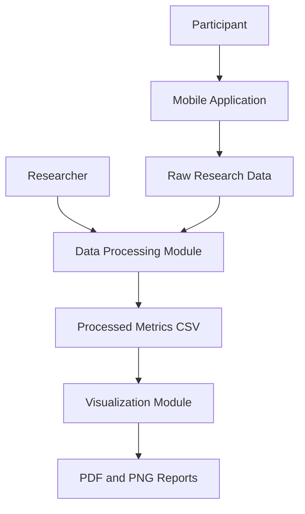

# Domain Model — Mobile UX Research

## 1. System Overview

The Mobile UX Research system is designed to evaluate how mobile application interface design affects user experience and task performance.

The research compares two interface versions:

- Baseline — the original interface.
- Improved — the redesigned interface.

The system collects user interaction data and processes it to calculate performance and usability metrics.

## 2. C4 Model

### 2.1 System Context

The main actors and external elements are:

- Researcher — prepares the experiment and analyzes results.
- Participant — performs tasks using the mobile application.
- Mobile Application — provides the Baseline or Improved interface.
- Research Dataset — stores collected experiment records.
- Analysis System — processes data and generates research visualizations.

### 2.2 Container Diagram

### 2.3 Main Components

| Component | Responsibility |
|---|---|
| Mobile Application | Displays the interface and allows users to perform tasks |
| Data Collection | Records task time, success, errors and satisfaction |
| Data Processing | Cleans and calculates research metrics |
| Metrics Summary | Stores aggregated results in CSV format |
| Visualization | Creates charts for comparing interface versions |
| Research Reports | Contains PDF and PNG figures |

## 3. STRIDE Threat Analysis

| Threat | Description | Mitigation |
|---|---|---|
| Spoofing | A person may pretend to be another participant | Use anonymous participant IDs |
| Tampering | Research records may be modified | Validate and protect raw data |
| Repudiation | A participant may deny performing an action | Keep timestamps and experiment logs |
| Information Disclosure | Personal information may be exposed | Avoid storing unnecessary personal data |
| Denial of Service | Research data may become unavailable | Keep backups of collected data |
| Elevation of Privilege | An unauthorized person may access research files | Restrict access to project files |

## 4. Mathematical Model

### 4.1 Average Task Completion Time

The average task completion time is calculated as:

\[
\bar{T} = \frac{1}{n}\sum_{i=1}^{n}T_i
\]

Where:

- \(T_i\) is the completion time for participant \(i\).
- \(n\) is the number of observations.

### 4.2 Task Success Rate

\[
Success\ Rate = \frac{N_{success}}{N_{total}}\times100
\]

The target success rate is at least 90%.

### 4.3 Error Rate

\[
Error\ Rate = \frac{N_{errors}}{N_{total}}\times100
\]

The target error rate is no more than 10%.

The denominator must be defined consistently in the final experiment.

### 4.4 Average Satisfaction

\[
\bar{S} = \frac{1}{n}\sum_{i=1}^{n}S_i
\]

Satisfaction is measured using a scale from 1 to 5.

### 4.5 Task Time Improvement

\[
Improvement = \frac{T_{baseline}-T_{improved}}{T_{baseline}}\times100
\]

A positive result indicates that the Improved interface reduced task completion time.

## 5. Experimental Conditions

### Independent Variable

Interface design version:

- Baseline
- Improved

### Primary Metric

Task completion time in seconds.

### Guardrail Metrics

- Task success rate should be at least 90%.
- Error rate should not exceed 10%.
- Critical UI errors should be zero.
- Satisfaction should not decrease.

### Controlled Conditions

- Device
- Operating system
- Task instructions
- Dataset
- Network conditions

## 6. Research Limitations

The sample dataset is used to test the data processing and visualization pipeline.

It contains only a small number of observations and must not be treated as final research evidence.

Final conclusions require data collected from the actual user experiment.

## 7. Conclusion

The domain model describes the main components, data flow, security considerations and mathematical metrics of the Mobile UX Research system.

It provides a foundation for analyzing and comparing the Baseline and Improved mobile application interfaces.
